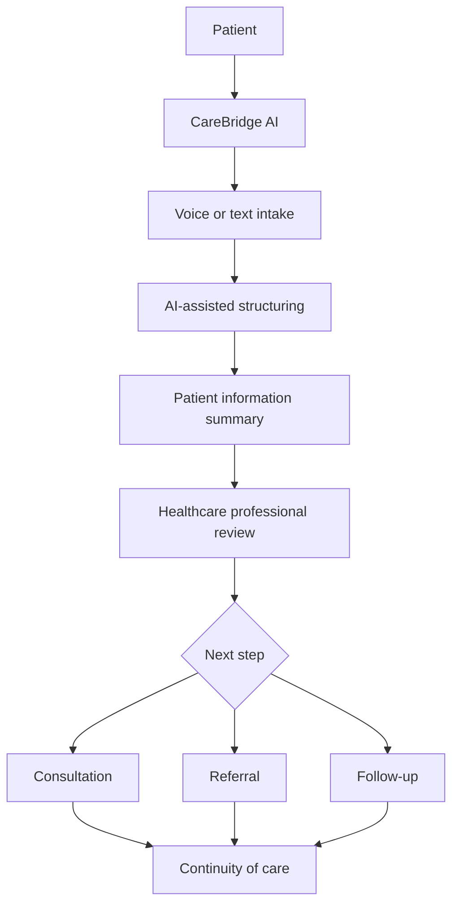

<div align="center">

# 🌉 CareBridge AI

### Connecting Care. Empowering Communities. Improving Lives.

**An inclusive, AI-assisted healthcare coordination platform designed to make essential healthcare journeys easier to access, understand, and navigate.**


[](https://github.com/swathi-dot4/whycode4uhack)

</div>

---

## The idea in one minute

Healthcare access is more than finding a hospital. Patients may struggle to explain symptoms in a language they are comfortable with, travel long distances, keep track of medical information, understand medicine instructions, or stay connected when internet access is unreliable.

**CareBridge AI brings key parts of the healthcare journey into one accessible digital experience.** It is designed to help patients communicate their concerns, organize information for healthcare professionals, navigate consultations and follow-ups, and access understandable health information.

> **Our guiding principle:** technology should reduce barriers between people and care—not create new ones.

## The problem

| Challenge | Why it matters |
|---|---|
| Language and communication barriers | Patients may find it difficult to describe their concerns clearly. |
| Distance and limited access | Reaching an appropriate healthcare professional can take time and money. |
| Fragmented patient information | Important context may be scattered across paper records and separate services. |
| Appointment uncertainty | Patients need clearer information about appointments and waiting. |
| Medicine information gaps | People may need help understanding medicine-related information. |
| Unreliable connectivity | Digital services can become difficult to use in low-connectivity settings. |
| Disconnected follow-up | Referrals and next steps can be hard to coordinate. |

## Our approach

CareBridge AI is designed as a connected healthcare-support experience rather than a collection of unrelated tools.

### Key solution areas

| Capability | Intended value |
|---|---|
| **Multilingual voice and text intake** | Helps patients communicate in a more accessible way. |
| **AI-assisted information structuring** | Turns patient-provided information into an organized summary for professional review. |
| **Digital health information** | Keeps relevant patient information easier to review and manage. |
| **Consultation support** | Supports remote interaction with healthcare professionals where enabled. |
| **MediScan / medicine information** | Helps users explore medicine information from appropriate sources. |
| **Appointment and queue coordination** | Makes appointment status and next steps easier to understand. |
| **Offline-friendly workflows** | Aims to support continuity when connectivity is intermittent. |
| **Referrals and follow-ups** | Helps patients keep track of care beyond a single interaction. |

**Implementation transparency:** The table describes the product direction and solution areas. Only features that are currently implemented and demonstrable in the deployed build should be presented as completed functionality during evaluation. Mark incomplete integrations as *planned* or *in development*.

## How it is intended to work



1. **Connect:** A patient opens the CareBridge AI experience.
2. **Share:** The patient provides information through the available input methods.
3. **Organize:** The platform helps structure the information for easier review.
4. **Review:** A qualified healthcare professional assesses the information.
5. **Coordinate:** The patient is guided toward an appropriate consultation, referral, or follow-up.
6. **Continue:** Relevant information helps support the next step in the healthcare journey.

## What makes the approach meaningful?

- **Patient-first:** Designed around barriers patients actually encounter.
- **Inclusive:** Considers language, accessibility, and digital-literacy needs.
- **Coordinated:** Focuses on the journey before and after a consultation, not only the consultation itself.
- **Connectivity-aware:** Treats intermittent internet access as a design constraint.
- **Human-supervised:** Positions AI as an assistance layer, not a replacement for clinical judgement.

## Technology

The repository uses a modern web application toolchain. Confirm the exact dependencies in `package.json` before presenting this list as the complete stack.

| Technology | Role |
|---|---|
| React | Component-based user interface |
| TypeScript | Typed application development |
| Vite | Local development and production build tooling |
| Tailwind CSS | Utility-first styling |
| Lucide React | Interface iconography |
| Vercel | Deployment / hosting |

> AI models, speech services, database systems, authentication, video infrastructure, OCR, and external healthcare APIs should be listed here only when they are actually integrated. Add each provider and its specific role once verified.

## Getting started

### Prerequisites

- Node.js (use the version supported by the project)
- npm
- Git

### Run locally

```bash
# 1. Clone the repository
git clone https://github.com/swathi-dot4/whycode4uhack.git

# 2. Enter the project directory
cd whycode4uhack

# 3. Install dependencies
npm install

# 4. Start the development server
npm run dev
```

Open the local address printed in your terminal.

### Production build

```bash
npm run build
```

Run the project's configured preview command, if available, to inspect the production build locally.

## Project links

- **Source repository:** https://github.com/swathi-dot4/whycode4uhack

## Responsible AI, safety, and privacy

Healthcare is a high-trust domain. CareBridge AI should be developed and evaluated with the following safeguards:

- Obtain informed consent before collecting or processing personal health information.
- Apply appropriate authentication, authorization, and data protection controls.
- Collect only the information needed for the intended workflow.
- Clearly distinguish AI-generated summaries from verified clinical records.
- Keep diagnosis, treatment, and prescribing decisions with qualified professionals.
- Use reliable, reviewed sources for medicine information.
- Provide clear emergency guidance and do not delay emergency care.
- Explain limitations and avoid presenting AI output as a definitive medical conclusion.

**CareBridge AI is a healthcare-support concept and must not be used as a substitute for professional medical advice, diagnosis, or emergency services.**

## Impact and alignment

CareBridge AI is intended to contribute to:

- **UN SDG 3 — Good Health and Well-being:** supporting more accessible healthcare journeys.
- **UN SDG 9 — Industry, Innovation and Infrastructure:** applying digital innovation to healthcare coordination.
- **UN SDG 10 — Reduced Inequalities:** considering barriers faced by underserved communities.

## Roadmap

- [ ] Validate the end-to-end patient journey with users and healthcare professionals.
- [ ] Add and test multilingual voice/text workflows.
- [ ] Integrate secure identity, consent, and role-based access.
- [ ] Connect verified health-information sources.
- [ ] Implement and test offline data handling and synchronization.
- [ ] Add measurable usability, accessibility, and reliability tests.
- [ ] Document deployment, environment variables, and system integrations.

## For hackathon evaluation

To make the project easy to assess, this repository should include:

1. A short demo video showing a complete user journey.
2. Screenshots of the actual running application.
3. A system architecture diagram that matches the implemented code.
4. A feature-status table distinguishing **Implemented**, **Prototype**, and **Planned**.
5. A brief testing section with real test results and known limitations.

### Suggested demo flow

`Problem → Patient journey → Key feature demonstration → Technical architecture → Impact → Future scope`

## Team

**Project:** CareBridge AI  
**Repository:** [swathi-dot4/whycode4uhack](https://github.com/swathi-dot4/whycode4uhack)  

Add the names, roles, and contribution links of every team member here before final submission.

---

<div align="center">

### 🌉 CareBridge AI
**Bridging the gap between people who need care and the people who provide it.**

*Built with purpose. Designed for access. Guided by empathy.*

</div>
